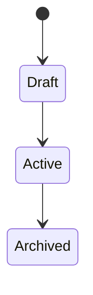

# Data Dictionary and Domain Model

**Version / commit:** `<version or SHA>`  
**Last verified:** `<YYYY-MM-DD>`

## Entity catalog

| Entity / table | Business meaning | Owner module | Primary key | Tenant / owner scope | Lifecycle / deletion | Evidence |
|---|---|---|---|---|---|---|
| | | | | | | |

## Entity fields

| Entity | Field | Type | Required? | Default | Constraints | Sensitive? | Meaning / source |
|---|---|---|---|---|---|---|---|
| | | | | | | | |

## Relationships and invariants

| Relationship | Cardinality | Constraint / invariant | Cascade behavior | Evidence |
|---|---|---|---|---|
| | | | | |

## Lifecycle and state machines

Replace with real states, transitions, guards and side effects.

## Data management

- Migrations and backfills:
- Indexes and high-volume queries:
- Transaction and concurrency rules:
- Retention and archival:
- Deletion / restore:
- Backup and restore:
- Export and portability:
