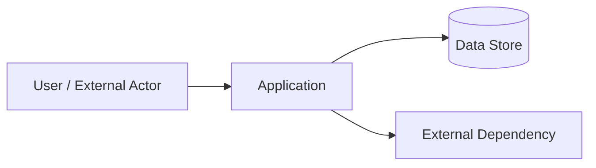

# System Architecture

## Scope and context

- System boundary:
- Users / actors:
- External systems:
- Environments covered:

## Architecture summary

<Describe the actual/proposed architecture. Explicitly label whether each statement describes the original system, target requirements or the new implementation.>

## Context diagram

Replace this placeholder with project-specific components and trusted boundaries.

## Runtime components

| Component | Process/deployment unit | Responsibility | Technology evidence | Dependencies |
|---|---|---|---|---|
| | | | | |

## Module boundaries

| Module | Owns | Does not own | Public contracts | Dependencies |
|---|---|---|---|---|
| | | | | |

## Important runtime flows

### Request flow

`<entry point> → <authn/authz> → <application logic> → <domain> → <persistence> → <response>`

### Async flow

`<trigger> → <event/job> → <consumer> → <side effect> → <retry/failure handling>`

## Data and consistency

- Authoritative data stores:
- Transaction boundaries:
- Consistency requirements:
- Cache/search strategy:
- Tenant boundaries:

## Security boundaries

- Identity provider / authentication:
- Authorization model:
- Sensitive data:
- External trust boundaries:

## Deployment and operations

- Topology:
- Configuration:
- Scaling assumptions:
- Health checks:
- Observability:
- Backup/recovery:

## Constraints and quality attributes

| Attribute | Target / evidence | Verification method | Status |
|---|---|---|---|
| Availability | | | |
| Performance | | | |
| Security | | | |
| Scalability | | | |
| Maintainability | | | |

## Decisions and trade-offs

- Link ADRs:

## Evidence, assumptions and open questions

- Verified:
- Inferred:
- Assumed:
- Unknown:
- Contradictions:
