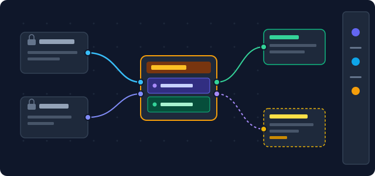

# Workflow Studio

An n8n-style visual graph editor and workflow orchestrator for DeepSeek Harness. Access it directly from the sidebar under **Workflow Studio**.

## Overview

Workflow Studio provides a real-time, interactive node-graph visualization of your active DeepSeek Harness composition. It bridges the running Cordis context, installed packages, MCP servers, and agent skills into an intuitive workflow canvas.

## Key Features

- **Live Harness Graph**: Automatically discovers and displays active core services, installed bundles, plugins, MCP connections (including exposed tools), agent presets, and loaded skills.
- **n8n-Style Node Canvas**: Nodes are organized by architectural tiers (Core, Presets, Plugins/Bundles, Tools/MCP, Skills/Drafts) with visual input/output handles, status indicators, and smooth bezier connections.
- **Safe Staging Workflow**: Edits are never directly forced into production profile files without review. All configuration edits, installs, and toggles are staged into the **Changes** drawer.
- **Inspector & Settings**: Inspect any node's metadata, package origin, exposed tools, and configuration fields. Easily update configs or add fields with automated secret masking (`••••••••`).
- **Unified Marketplace**: Search across official DeepSeek packages, community npm plugins, GitHub topics, and the Model Context Protocol (MCP) registry. Compare alternatives side-by-side.
- **AI Copilot & Scaffolder**: Collapsible AI assistant powered by DeepSeek or OpenAI-compatible backends. Ask questions about your setup, request architectural audits, or generate custom plugin, MCP, or skill scaffolding.
- **One-Click Auto Layout & Fit**: Reorganize complex multi-tier graphs instantly with the Auto Layout engine, and focus on the full graph with Fit-to-screen.

## Security & Secrets Policy

- Secret-bearing fields (such as `apiKey`, `token`, `password`, `secret`) are masked with `••••••••` on the host before sending to the client.
- When saving staged changes, unmodified masked values are restored from the host's existing configuration, preventing secret leaks.
- API keys for the AI copilot are stored locally in `$DSH_HOME/studio/ai.json` with strict owner-only file permissions (`0o600`), or read securely from ambient environment/credential stores.

## AI Assistant Configuration

Click the ⚙ gear icon in the Assistant panel to specify your OpenAI-compatible base URL and API key (DeepSeek default: `https://api.deepseek.com`, model: `deepseek-chat`). You can also provide `DEEPSEEK_API_KEY` or `OPENROUTER_API_KEY` in your environment or harness credentials.
