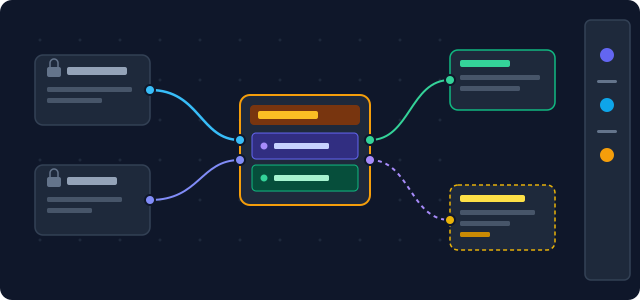

# 工作流工作台 (Workflow Studio)

专为 DeepSeek Harness 打造的 n8n 风格可视化节点图编辑器与工作流编排中心。在侧边栏直接点击 **Workflow Studio** 即可打开。

## 功能概览

Workflow Studio 将运行中的 Cordis 运行时上下文、已安装的插件包、MCP 服务和智能体技能以实时、交互式的节点图形式呈现，让 Harness 的架构与编排一目了然。

## 核心特性

- **实时 Harness 节点图**：自动发现并可视化正在运行的核心服务、已安装的 Bundle、插件行、MCP 连接（包括暴露的工具列表）、智能体预设及已加载的技能。
- **n8n 风格画布**：按照架构层级（核心服务、预设、插件/Bundle、工具/MCP、技能/草稿）自动分层布局，具备输入/输出连接点、状态指示灯和流畅的贝塞尔连接曲线。
- **安全的暂存机制 (Staging)**：任何修改都不会直接盲目写入底层配置。配置修改、安装与开关均首先暂存在 **Changes** 抽屉中，供用户审核后一键应用。
- **检查器与设置面板**：点击任意节点即可查看其元数据、来源包、导出的工具列表以及配置字段。支持在线编辑配置或新增字段，自动屏蔽敏感密钥（`••••••••`）。
- **统一插件市场**：一站式检索官方 DeepSeek 插件包、社区 npm 插件、GitHub 仓库主题以及 MCP 注册表，并支持多插件横向对比。
- **AI 助手与脚手架**：右侧内置可折叠的 AI 助手（基于 DeepSeek 或兼容 OpenAI 协议的接口）。可随时提问 Harness 架构、诊断冗余、或自动生成新插件、MCP 与技能草稿。
- **一键自动布局与自适应**：提供“Auto Layout”一键整理复杂连线与节点，“Fit”一键自适应居中画布。

## 安全与隐私规范

- 所有包含敏感信息的字段（如 `apiKey`、`token`、`password`、`secret`）在宿主端发送至前端前均自动屏蔽为 `••••••••`。
- 保存暂存修改时，未更改的屏蔽字段会自动从宿主现存配置中还原真实值，杜绝密钥泄露风险。
- AI 助手的密钥保存在本地 `$DSH_HOME/studio/ai.json` 中，仅限当前用户权限（`0o600`），亦可直接从环境或 Harness 凭证中读取。

## AI 助手配置说明

在 AI 助手面板中点击 ⚙ 设置图标，可填入兼容 OpenAI 规范的 API 基础地址与密钥（默认 DeepSeek：`https://api.deepseek.com`，模型：`deepseek-chat`），或在环境变量/凭据管理中配置 `DEEPSEEK_API_KEY` 或 `OPENROUTER_API_KEY`。
